<div align="center">

# 🗣️ FastSpeech 2 Text-to-Speech
### Turn written **English** and **Telugu** into natural-sounding speech


**Type a sentence → get a spoken audio file.**
Two separate models, one per language, trained from scratch on Indian speech data.

[Quick start](#-quick-start) · [Listen to samples](#-listen-to-the-samples) · [Results](#-results) · [Report](Report/Technical_Report.pdf)

</div>

---

## ✨ At a glance

| | 🇬🇧 English | 🇮🇳 Telugu |
|---|---|---|
| **Training data** | IISc Svarah (Indian English) | IIT Madras IndicTTS (female voice) |
| **Speakers** | 3 | 1 |
| **Training audio** | about 5.0 hours (3,457 utterances) | about 1.7 hours (843 utterances) |
| **Phoneme set** | 78 symbols (ARPAbet) | 58 symbols (rule-based) |
| **Trained for** | 20,000 steps | 20,000 steps |
| **Checkpoint used** | step 7,000 (`best.pth`) | step 2,000 (`best.pth`) |

All audio is produced at **22,050 Hz, 16-bit, mono** using a pretrained **HiFi-GAN** vocoder.

---

## 🧠 How it works (in plain words)

A computer cannot read text out loud directly. It does it in steps:

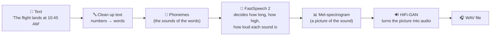

**Why FastSpeech 2?** Older systems (like Tacotron 2) speak one small piece at a time and can stumble, repeat or skip words. FastSpeech 2 produces the whole sentence **in parallel**, so it is fast and does not lose its place.

The key idea is the **variance adaptor**. Before producing sound, the model first predicts three things for every phoneme:

| 🎚️ What | 💡 Meaning |
|---|---|
| **Duration** | how long the sound lasts |
| **Pitch** | how high or low the voice is |
| **Energy** | how loud it is |

---

## 🚀 Quick start

```bash
# 1. Get the code
git clone <repo_url>
cd fast_speech_2

# 2. Create a virtual environment
python -m venv .venv
source .venv/bin/activate          # Windows: .venv\Scripts\Activate.ps1

# 3. Install everything
pip install -r requirements.txt
python -c "import nltk; nltk.download('averaged_perceptron_tagger_eng'); nltk.download('averaged_perceptron_tagger')"
```

### 🎧 Generate speech

```bash
# English
python English/inference.py --checkpoint English/checkpoints/best.pth --out_dir Results/English --device cpu

# Telugu
python Telugu/inference.py --checkpoint Telugu/checkpoints/best.pth --out_dir Results/Telugu --device cpu
```

Each command writes five WAV files to `Results/<Language>/test_generated_audios/`. Use `--device cuda` if you have a GPU.

### 🎛️ Change how it sounds

```bash
# 20% faster and 10% higher pitch (Telugu)
python Telugu/inference.py \
  --checkpoint Telugu/checkpoints/best.pth \
  --duration_control 0.8 \
  --pitch_control 1.1 \
  --energy_control 1.0 \
  --device cpu
```

<details>
<summary><b>🛠️ Rebuild the models from scratch (preprocess and train)</b></summary>

```bash
# Extract features (mel-spectrograms, pitch, energy) — normalisation uses training data only
python English/preprocess.py English/config.yaml
python Telugu/preprocess.py Telugu/config.yaml

# Train (single GPU, multi-GPU or CPU)
python English/train.py --config English/config.yaml --device cuda
python Telugu/train.py  --config Telugu/config.yaml  --device cuda

# Quick 100-step check that everything runs
python English/train.py --smoke_test --max_steps 100 --device cpu
python Telugu/train.py  --smoke_test --max_steps 100 --device cpu
```

Training setup: Adam optimiser, 4,000 warm-up steps, batch size 16, gradient clipping at 1.0, seed 1234, validation on the full validation set every 500 steps.

</details>

---

## 🎧 Listen to the samples

Each language has five test sentences, chosen to be tricky on purpose.

### English

| ID | What it tests | Length | Audio |
|:--:|---|:--:|:--:|
| **E1** | A very long word: *antidisestablishmentarianism* | 10.25 s | [▶ E1.wav](Results/English/test_generated_audios/E1.wav) |
| **E2a** | *conduct* as a **noun** (stress on the first syllable) | 6.59 s | [▶ E2a.wav](Results/English/test_generated_audios/E2a.wav) |
| **E2b** | *conduct* as a **verb** (stress on the second syllable) | 8.58 s | [▶ E2b.wav](Results/English/test_generated_audios/E2b.wav) |
| **E3** | A typo with a stray space: *rhyth m* | 7.64 s | [▶ E3.wav](Results/English/test_generated_audios/E3.wav) |
| **E4** | Numbers and dates (*10:45 AM*, *12 November 2026*) and an unknown word (*andaroo*) | 10.15 s | [▶ E4.wav](Results/English/test_generated_audios/E4.wav) |

### తెలుగు (Telugu)

| ID | What it tests | Length | Audio |
|:--:|---|:--:|:--:|
| **T1** | A long technical word: *న్యూరోఫార్మకోలాజికల్* | 7.19 s | [▶ T1.wav](Results/Telugu/test_generated_audios/T1.wav) |
| **T2a** | *పట్టు* meaning **grip** | 4.54 s | [▶ T2a.wav](Results/Telugu/test_generated_audios/T2a.wav) |
| **T2b** | *పట్టు* inside the word *పట్టుచీరను* (**silk** saree) | 4.46 s | [▶ T2b.wav](Results/Telugu/test_generated_audios/T2b.wav) |
| **T3** | A short story sentence: *పులి అడవిలో వేగంగా పరిగెత్తింది.* | 3.85 s | [▶ T3.wav](Results/Telugu/test_generated_audios/T3.wav) |
| **T4** | A date and time read out in Telugu (*2026*, *10:45*, *12వ*) | 11.24 s | [▶ T4.wav](Results/Telugu/test_generated_audios/T4.wav) |

> The test sentences were removed from the training data before training, so the models never saw them.

---

## 📈 Results

### Training curves

Lower is better. The big drop at the start is the model learning quickly; the flat part afterwards means it has settled. Each picture shows the total loss and its parts (mel-spectrogram, pitch, energy and duration).

**🇬🇧 English — training**
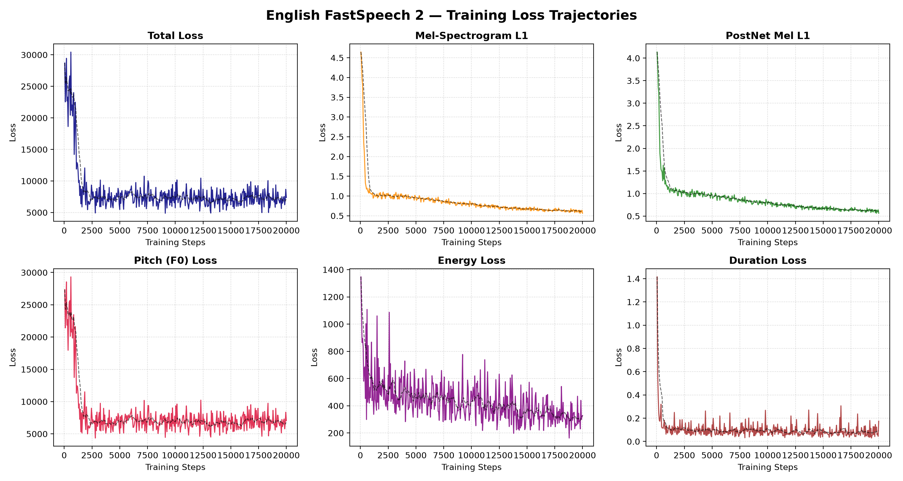

**🇬🇧 English — validation** (on audio the model has not trained on)
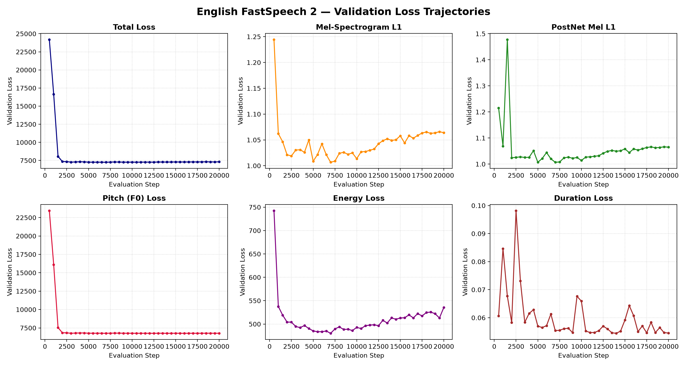

**🇮🇳 Telugu — training**
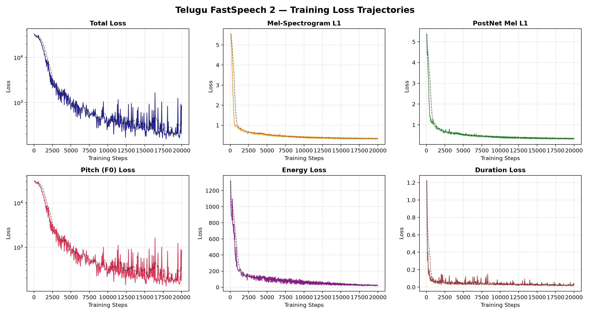

**🇮🇳 Telugu — validation**
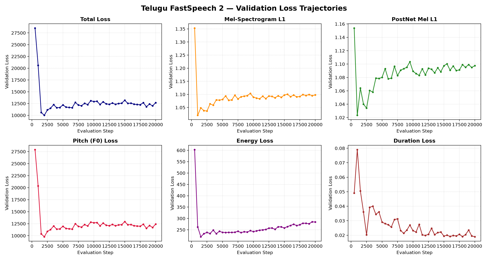

### 🔍 Inside the model: duration, pitch and energy

These plots show what the variance adaptor predicted for the test sentences. Blue bars are phoneme durations; the colourful picture underneath is the generated mel-spectrogram (the "picture of the sound").

> ⚠️ In the pitch plots the predicted pitch sits near 600 Hz for most of each sentence, which is not a realistic voice. Read the pitch panels as a known issue, not as proof of intonation modelling.

**Stress in English: *conduct* as a noun (E2a) and as a verb (E2b)**
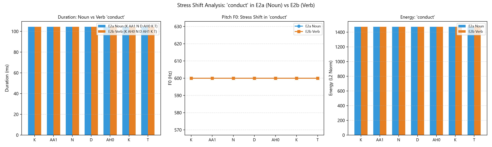

**Meaning in Telugu: *పట్టు* as grip (T2a) and inside the silk compound (T2b)**
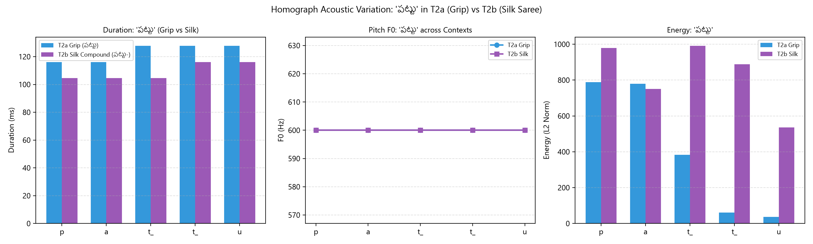

**E1 — the long word *antidisestablishmentarianism*: durations**
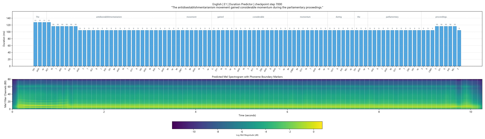

**E1 — pitch contour over the spectrogram**
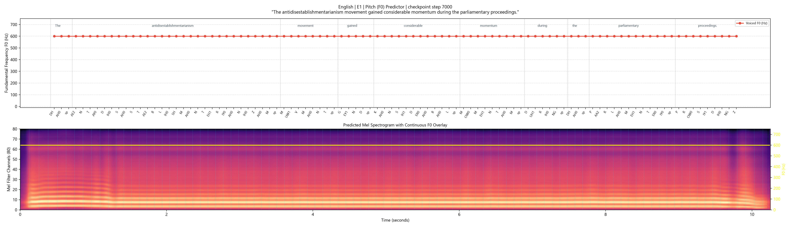

**E4 — numbers, dates and the unknown word *andaroo*: durations**


**T1 — the long Telugu technical word: durations**
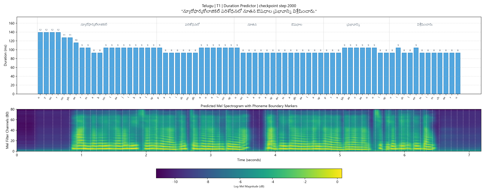

**T1 — pitch contour over the spectrogram**
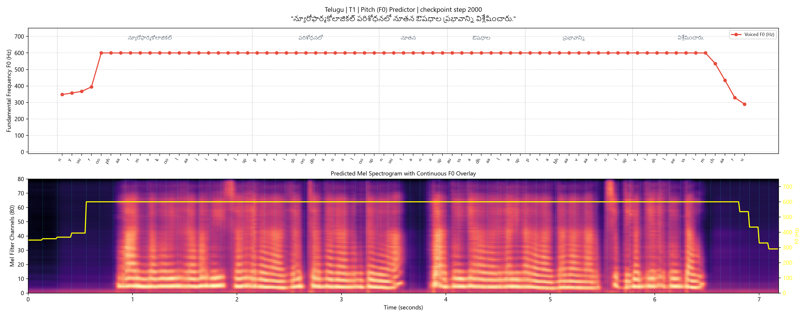

**T4 — Telugu date and time read out in words: durations**
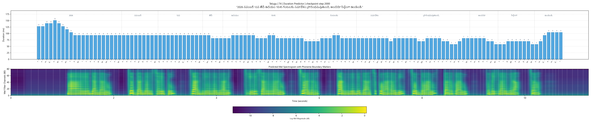

### Numbers at the best checkpoint

| Model | Step | Mel L1 | Duration loss |
|---|:--:|:--:|:--:|
| English | 7,000 | 1.0067 | 0.0554 |
| Telugu | 2,000 | 1.0381 | 0.0361 |

*Mel L1 measures how close the generated sound picture is to the real one (lower is better).*

### What we found

- ✅ **Stable on long and tricky text.** All ten sentences came out without skipped or repeated syllables, including the 28-letter English word and the long Telugu technical word.
- ✅ **Numbers and dates work.** Times and dates are turned into words before synthesis in both languages.
- ✅ **Word stress is audible in English.** A part-of-speech rule gives *conduct* different sounds as a noun and as a verb, and the difference can be heard.
- ⚠️ **Telugu overfits early.** With only about 1.7 hours of training audio, the Telugu model gets its best score at step 2,000 and then slowly gets worse on unseen data. More Telugu data would help.
- ⚠️ **Pitch plots need work.** In the variance-adaptor plots the predicted pitch sits near 600 Hz for most of each sentence, which is not a realistic voice. Because of this, the plots cannot be used as proof of how stress or intonation is modelled. This is being investigated.

The full set of variance-adaptor plots for every test sentence is in `Results/<Language>/variance_adaptor_plots/`.

📄 Full details, tables and all figures are in the **[Technical Report](Report/Technical_Report.pdf)**.

---

## 🔧 What we fixed in the reference code

This project starts from [`ming024/FastSpeech2`](https://github.com/ming024/FastSpeech2). After a code audit, these problems were fixed:

| 🧩 Part | ❌ Problem | ✅ Fix |
|---|---|---|
| **Variance adaptor** (`modules.py:124`) | Pitch control was passed where energy control belonged | Pass the energy control, so pitch and energy are controlled separately |
| **Length regulator** (`modules.py:168`) | Crashed on empty sequences or all-zero durations | Added a default, device handling and a 1-frame minimum |
| **Optimizer resume** (`optimizer.py:42`) | Resuming training restarted the learning rate from step 0 | Save and restore the scheduler state |
| **Data leakage** (`preprocessor.py:84`) | Normalisation statistics used validation data too | Statistics are computed on training data only |
| **Telugu text** | No support for Telugu script | New 58-symbol rule-based converter that handles conjunct letters |
| **Pitch at inference** | The exponential used to restore pitch could overflow | Result limited to 20–1000 Hz |

---

## 📁 Project structure

```
fast_speech_2/
├── English/                    # English model and its scripts
│   ├── train.py                # training
│   ├── preprocess.py           # feature extraction
│   ├── inference.py            # text → speech
│   ├── config.yaml             # settings
│   └── checkpoints/            # best.pth (140.5 MB), last.pth (140.5 MB)
├── Telugu/                     # Telugu model and its scripts (same layout)
│   └── checkpoints/            # best.pth (140.4 MB), last.pth (140.4 MB)
├── Results/
│   ├── English/                # loss curves, test_generated_audios/, variance_adaptor_plots/
│   └── Telugu/                 # loss curves, test_generated_audios/, variance_adaptor_plots/
├── docs/
│   └── images/                 # figures used in this README (same as in the report)
├── Report/
│   └── Technical_Report.pdf    # the full technical report
├── README.md
└── requirements.txt
```

<details>
<summary><b>🔐 Checkpoint verification (SHA-256)</b></summary>

| Language | File | Size | SHA-256 |
|:--|:--|:--:|:--|
| English | `English/checkpoints/best.pth` | 140.5 MB | `84c421d9e03d77cd3f732064b75393fe7abb95f60d06427fa6deb61dd69e5192` |
| Telugu | `Telugu/checkpoints/best.pth` | 140.4 MB | `82b39fe49ebe0012837fda23a25ac95eb869bc4271a70c10bc9d40becbe315e3` |

</details>

---
